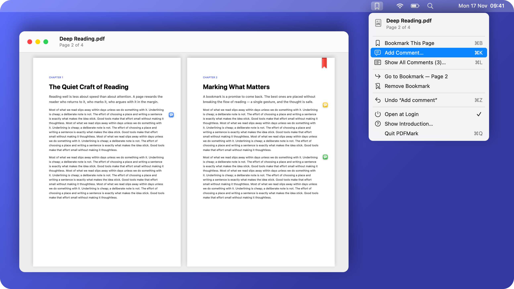
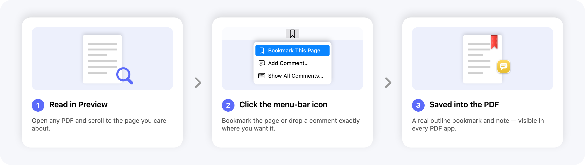
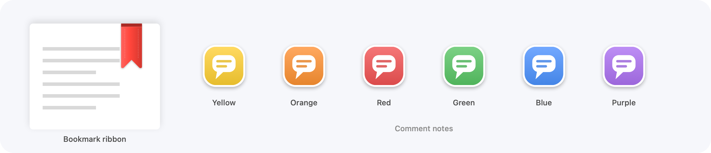
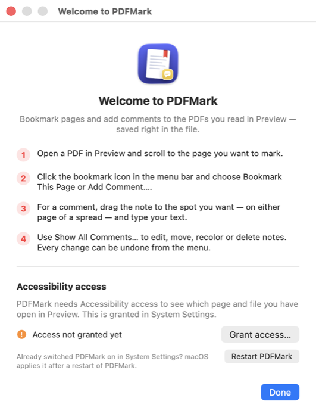

<p align="center">
  
</p>

<h1 align="center">PDFMark</h1>

<p align="center">
  <b>Bookmarks and comments for the PDFs you read in Preview — saved right in the file.</b><br>
  A tiny menu-bar app for macOS. One click while you read, nothing to set up.
</p>

<p align="center">
  <a href="https://github.com/aleamu27/pdfmark/releases/latest"></a>
</p>

<p align="center">
  
  
  
  
</p>

<p align="center">
  
</p>

---

## Why PDFMark?

Preview is a great PDF reader, but it can't place a lasting bookmark or a
well-placed comment without getting in your way. PDFMark sits in the menu bar
and does exactly that, on whatever page you're reading.

<table>
  <tr>
    <td width="50%" valign="top">
      <h3>🔖 Real bookmarks</h3>
      A genuine outline entry in the PDF plus a red ribbon on the page. It shows
      up in Preview's table of contents (<code>⌘⌥3</code>) and in every other PDF app.
    </td>
    <td width="50%" valign="top">
      <h3>💬 Comments where you want them</h3>
      Drag the note to the exact spot, on either page of a spread, pick a color
      and type. Saved as a standard PDF note that opens in any viewer.
    </td>
  </tr>
  <tr>
    <td valign="top">
      <h3>🗂 All comments in one place</h3>
      Search, edit, recolor, move notes to another page, jump to them in Preview,
      or copy them all as text. Notes made in Preview show up too.
    </td>
    <td valign="top">
      <h3>↩️ Undo everything</h3>
      Every change can be undone from the menu. PDFMark keeps the last 20 versions
      of each document and only ever changes what you ask it to.
    </td>
  </tr>
  <tr>
    <td valign="top">
      <h3>📄 Stays in the file</h3>
      No library, no account, no sidecar database. Send the PDF to someone and
      your bookmarks and notes go with it.
    </td>
    <td valign="top">
      <h3>🔒 Private by design</h3>
      PDFMark never connects to the internet. It reads which page Preview shows
      and writes to the PDF on your Mac. That's it.
    </td>
  </tr>
</table>

## How it works

<p align="center">
  
</p>

1. **Read** a PDF in Preview.
2. **Click** the bookmark icon in the menu bar. The menu shows the document and
   page you're on: choose **Bookmark This Page** or **Add Comment…**.
3. **Done.** PDFMark writes the change into the file and reopens it in Preview
   at the same page, so you see it immediately.

Only one PDFMark bookmark is kept per document: setting a new one moves it,
and your document's own table of contents is never changed.

## Looks good everywhere

<p align="center">
  
</p>

The ribbon and the notes are crisp vector artwork stored in the PDF itself (as
standard annotation appearances), so they look the same in any PDF viewer that
shows annotations, not just in Preview. They sit *on top of* the page and never
change its content.

## Install

1. **[Download the latest `PDFMark.dmg`](https://github.com/aleamu27/pdfmark/releases/latest)**,
   open it and drag **PDFMark** into **Applications**.
2. Open PDFMark from Applications.
   <details>
   <summary>macOS says it can't verify the developer?</summary>

   PDFMark isn't notarized by Apple yet. Click **Done**, open
   *System Settings → Privacy & Security*, scroll down and click **Open Anyway**.
   You only need to do this once.
   </details>
3. Follow the short introduction: switch PDFMark on under
   *Accessibility* in System Settings, then click **Restart PDFMark**.

<p align="center">
  
</p>

That's all: one app, no other downloads. Turn on **Open at Login** in the menu
if you want PDFMark always ready.

<details>
<summary><b>Why does PDFMark need Accessibility access?</b></summary>

Preview doesn't tell other apps which page or file you're looking at. With
Accessibility access PDFMark can read that from Preview's window (and scroll
back to the right page after saving). It doesn't read or record anything else.
</details>

<details>
<summary><b>Is my PDF safe?</b></summary>

Before every change PDFMark saves a copy of the PDF in
`~/Library/Application Support/PDFMark/Undo` (the last 20 per document), and
Preview's window is closed while the file is written so Preview's own edits are
saved first. Use **Undo** in the menu to go back.
</details>

## Requirements

- macOS 13 Ventura or later, on Apple Silicon or Intel
- Preview (built into macOS)

---

## For developers

PDFMark is Swift + AppKit + PDFKit with a little SwiftUI, built with Swift
Package Manager. **No third-party dependencies, no Xcode project.**

```bash
./build.sh                    # dev build → build/PDFMark.app (signed with your Apple Development cert)
open build/PDFMark.app

./scripts/release.sh          # universal release → dist/PDFMark-<version>.dmg + .zip
./scripts/make_icon.sh        # regenerate Resources/AppIcon.icns
./scripts/make_readme_images.sh  # regenerate the images in docs/images/
```

<details>
<summary><b>Releasing, signing & notarization</b></summary>

With a **Developer ID Application** certificate in the keychain, `release.sh`
signs the app and DMG with it (hardened runtime). Set `NOTARY_PROFILE` to also
notarize and staple, which removes the "Open Anyway" step for users:

```bash
xcrun notarytool store-credentials pdfmark --apple-id <apple-id> --team-id <team-id>
NOTARY_PROFILE=pdfmark ./scripts/release.sh
```

Without one the release is ad-hoc signed. Bump `CFBundleShortVersionString` /
`CFBundleVersion` in `Resources/Info.plist` before each release, then attach the
DMG to a GitHub release. Releases use bundle id `no.pdfmark.app`; `build.sh`
dev builds use `no.pdfmark.app.dev2`, so their Accessibility grants never
interfere. `build.sh` signs with a stable Apple Development identity because TCC
keys the Accessibility grant to the code signature — ad-hoc signatures change
every build and silently revoke it.
</details>

<details>
<summary><b>Page detection</b></summary>

Preview's window title (`AXTitle`, e.g. *"Page 3 of 28"*) only reflects the live
page transiently right after a scroll, then goes stale. PDFMark reads the page
from Preview's accessibility tree instead: the `AXPage` elements that are
currently visible (`AXVisibleChildren`), with a geometric fallback — inside the
`AXScrollArea` holding the pages, the current page is the one whose vertical
extent straddles the center of the visible frame:

$$
c_y = v_y + \frac{v_h}{2}, \qquad
p^\star = \{\, P_i \mid y^{\text{bot}}_i \le c_y \le y^{\text{top}}_i \,\}.
$$

The same tree is used to find the open file and to scroll Preview back to a
page (`AXScrollToVisible`) after the PDF is reopened.
</details>

<details>
<summary><b>What PDFMark writes into the PDF</b></summary>

| Addition | PDF object | How PDFMark recognizes its own |
| --- | --- | --- |
| Bookmark | `PDFOutline` entry after the document's own outline | zero-width space `\u{200B}` appended to the label |
| Ribbon | `/Stamp` annotation, 24×44 pt, top-right corner | `userName = "PDFMark"` (the `/T` field) |
| Comment | standard `/Text` note annotation + popup | — (all notes are listed, including Preview's) |

The ribbon and note artwork (`MarkerArt.swift`) is drawn with Core Graphics in
the annotations' `draw(with:in:)`, which PDFKit bakes into each annotation's
appearance stream on save — that's why it renders identically in every viewer.
PDF shadings can't carry transparency (it renders as black), so the artwork uses
only opaque gradients. A custom key in `documentAttributes` was tried for
tagging and does **not** survive `PDFDocument.write(to:)`.
</details>

<details>
<summary><b>Architecture</b></summary>

```
Sources/PDFMark/
├── PDFMarkApp.swift           # @main AppDelegate: menu, flows, login item, app location
├── StatusIconController.swift # menu-bar item + success/error flash
├── PreviewInspector.swift     # AX: current file + page, close/reopen, scroll-to-page
├── BookmarkWriter.swift       # outline entry + ribbon, single-bookmark logic
├── CommentStore.swift         # read/add/edit/move/delete note annotations
├── MarkerArt.swift            # vector artwork for ribbon + note badge (PDF, UI, icon)
├── CommentPanel.swift         # "new comment" panel
├── CommentsWindow.swift       # comments window (list, search, inspector)
├── PagePicker.swift           # page thumbnails with a draggable note marker
├── ConfirmPanel.swift         # "which page?" bookmark panel
├── UndoHistory.swift          # per-document undo snapshots
├── Toast.swift                # confirmation bubble under the menu-bar icon
├── EditingSupport.swift       # ⌘C/⌘V/… in a menu-bar app, window animations
└── OnboardingWindow.swift     # introduction + live Accessibility status
```

`Spikes/` holds the standalone experiments used to figure out Preview's AX tree
and PDFKit's behaviour; they're not part of the app build.
</details>

<details>
<summary><b>Known limitations</b></summary>

- **Not notarized yet** — that needs a paid Apple Developer account. Until then
  downloads need a one-time *Open Anyway*, and since ad-hoc signatures change
  with every release, Accessibility must be re-granted after updating.
- **Global hotkey `⌥⌘B`** is wired up but doesn't fire on every setup; the
  menu-bar icon is the reliable way in.
- **Right-click → Services** entry in Preview is registered but not shown by
  macOS (legacy `NSServices` appear to require a Developer ID signature).
</details>

## License

MIT — see [`LICENSE`](LICENSE). Changes are listed in [`CHANGELOG.md`](CHANGELOG.md).
